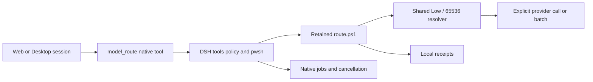

# DSH model routing plugin v0.1.0

Native Cordis plugin for DSH Web and Desktop 0.2.1-rc.2. No runtime npm dependencies.

`plugin/index.mjs` registers `model_route` in a session preset's existing tools registry.
The adapter validates arguments, quotes PowerShell data, then calls the native
`ctx.tools.execute({name: 'pwsh', ...})` with the caller's agent, parent and signal.
DSH owns policy/approval, working directory, output limits and job lifecycle. The
existing `scripts/route.ps1` owns transport, per-model settings and receipts.
No second scheduler, provider, cache, model catalog or agent loop is introduced.



## Install

Place the full repository (without .git and .state) in a DSH skill directory.
Insert the following row into each target registered preset's `plugins` list:

```yaml
- id: model-routing
  name: file:///ABSOLUTE/INSTALL/plugin/index.mjs
```

Use an actual file URL. Optional `config.cliRoot` points to another retained CLI
root; otherwise the plugin resolves its parent directory. Keep this session-scoped:
registering globally can duplicate tools or leak across preset isolation. The small
root SKILL.md provides companion instructions. No npm install is necessary.

## Use

```json
{"operation":"settings","model":"deepseek-v4.1-flash:1017-cloud"}
{"operation":"call","model":"deepseek-v4.1-flash:1017-cloud","prompt":"Summarize the supplied text."}
{"operation":"batch","model":"deepseek-v4.1-flash:1017-cloud","promptFile":"items.jsonl","parallel":2,"background":true}
{"operation":"report"}
```

Settings/report do not generate tokens. Call/batch require authorization for the
work and an explicit model. The plugin never changes chat or subagent defaults.
Exact DeepSeek 1017 defaults to Low and 65536 output tokens; no num_ctx is sent.
Optional effort/maxTokens override both paths. Other models retain their settings;
other cloud batch IDs remain blocked. For long prompts use promptFile (the
Windows command length is bounded). Batch paths are relative to the session
workspace, including output. Native shell output and nonzero exits are retained,
not interpreted as successful model results. For background work use native
job_output/job_kill. No automatic retry. Cancellation uses DSH's existing process
policy, including its process-tree behavior; the plugin does not promise more.

CLI remains usable exactly as before. Its .state ledger stays local and ignored.
Cloud costs are API-equivalent estimates, never subscription bills. The current
working CLI is Windows/PowerShell specific; no Linux compatibility is claimed.

## Offline verification

Run `node scripts/test_plugin_offline.mjs <Web-host-package.json> <CLI-root>`.
This uses the installed DSH ToolRuntime and real CLI against an ephemeral
127.0.0.1 HTTP mock. It checks actual call/batch Low/65536 bodies, no num_ctx,
local preservation, blocked other-cloud requests, overrides, receipt settings,
nested policy denial, pre-start cancellation and native background forwarding.
The executor substitutes the process launch only; no model runs. Background
forwarding is a stubbed job ID, not a live background-job acceptance test.
The test also validates schema registration with the installed native registry.

Installed runtime availability must be checked separately from source and offline
proof. Existing presets can hot-reload only when the host loader supports it;
do not interrupt active work simply to load a plugin.
