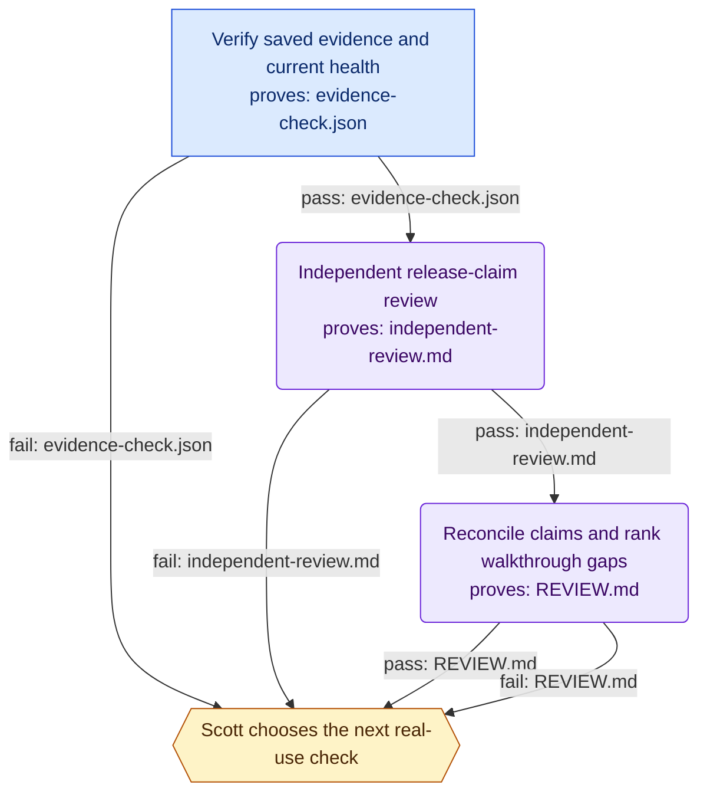

# halo-release-review

**Goal.** Reconcile the deployed Halo release claims with independent evidence and hand Scott a bounded operator walkthrough without changing production.

**Trigger.** Scott requested continuation with Workflowwright after production delivery on 2026-09-02.

**Isolation.** `none`

**Shape.** 4 nodes — 1 code, 2 agent, 1 human; 6 edges, 0 of them loops.

## Diagram

## Nodes

| Node | Who | What | Model | Retries | Proves it worked |
|---|---|---|---|---|---|
| `verify_evidence` | Code | Run Node verify-evidence.mjs with this directory as its output argument. Read test records, current source hashes, recovery hashes, Git ancestry and three HTTP health endpoints. Do not run new inference, alter services, or read credentials. | — | — | `evidence-check.json` |
| `independent_review` | Agent | Existing independent subagent reviews the fixed release documents, evidence and pertinent source. Identify unsupported claims and at most three high-value operator gaps. Task is read-only; do not remove native tool permissions. Review can run alongside evidence collection, but reconciliation consumes both completed outputs. | default | — | `independent-review.md` |
| `reconcile` | Agent | Parent combines the deterministic receipt and independent review. Distinguish historical test proof, current hashes, current health, native two-turn continuity, checkpoint behavior and untested operator outcomes. No automatic repair, rollout, regression campaign or provider login is authorized by a review failure. | default | — | `REVIEW.md` |
| `operator_handoff` | Human | Present the findings and offer startup/recovery, long-conversation continuity, or a specific connected provider as the next walkthrough. Record a decision only after Scott actually makes it; no fabricated acceptance or automatic restart. | — | — | — |

Nodes with an artifact named above cannot pass their claim of success downstream without it: the run treats a missing or empty file as a failure of that node. The bar is that the artifact exists and is not empty, which catches a step that silently did nothing — not a step that writes something worthless.

## Flow

| From | Condition | Carries | To |
|---|---|---|---|
| `verify_evidence` | pass | `evidence-check.json` | `independent_review` |
| `verify_evidence` | fail | `evidence-check.json` | `operator_handoff` |
| `independent_review` | pass | `independent-review.md` | `reconcile` |
| `independent_review` | fail | `independent-review.md` | `operator_handoff` |
| `reconcile` | pass | `REVIEW.md` | `operator_handoff` |
| `reconcile` | fail | `REVIEW.md` | `operator_handoff` |

## Where people are involved

- **`operator_handoff` — Scott chooses the next real-use check.** Present the findings and offer startup/recovery, long-conversation continuity, or a specific connected provider as the next walkthrough. Record a decision only after Scott actually makes it; no fabricated acceptance or automatic restart.

Human touchpoints belong at intake and acceptance, plus any step whose next action is irreversible. Interior gates cap throughput at one person's attention regardless of available compute — if any of the above sits in the middle, check that the action after it genuinely cannot be undone.

## Model and tool allocation

| Node | Backend | Model | Tools | Payload goes to |
|---|---|---|---|---|
| `independent_review` | codex | default | all | OpenAI |
| `reconcile` | codex | default | all | OpenAI |

Scouting and planning decide what everything downstream does, so errors there propagate and get faithfully implemented — those are the nodes worth the strongest model. Mechanical transforms are where a cheaper tier pays off. Narrowing tools on read-only nodes is both a cost control and a safety property.

## Open questions

Unresolved. Each of these is a hole in the design, deliberately left visible:

- This is a Workflowwright critique reconstruction of the CURRENT review, not a claim that the earlier implementation used generated orchestration.
- Agent-call and attempt limits describe this two-agent review plan; no scaffolded persistent runtime driver was installed. The parent performed one review dispatch and one reconciliation.
- Which operator check does Scott want next? No walkthrough acceptance decision has been supplied.
- Automatic service persistence, forced native near-limit compaction, and unconnected cloud-account entitlement remain outside the completed acceptance evidence.

## Testing a single node

Every edge names its payload, so any node can be run against a fixed input rather than by replaying the whole workflow. The generated scaffold exposes this as `--only <node>`, reading that node's inputs from the run directory. Retry granularity is node granularity: if debugging forces you to rerun everything, the boundaries are in the wrong place.
